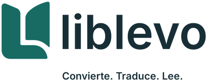

# Convierte tus documentos sin perder de vista el original

Liblevo te ayuda a convertir PDF, incluidos los escaneados, en archivos que puedes leer, corregir
y reutilizar. Ves cada página junto al resultado, revisas los fragmentos dudosos y exportas a
Markdown o EPUB. También puedes traducir el contenido en tu propio equipo.

**Tus documentos se procesan en tu ordenador.** La app no los envía a un servicio remoto ni recoge
datos de uso. Los componentes necesarios se descargan solo cuando los eliges en la app.

> **Estado:** código fuente de la versión 0.1 para Windows. Todavía no hay un instalador publicado
> en GitHub. Queda pendiente probar la instalación y el uso con documentos reales antes de ofrecer
> una descarga a otras personas.

## Instalación y primeros pasos

Si ya tienes el instalador de esta versión (`Liblevo_0.1.0_x64-setup.exe`):

1. Ábrelo en un equipo Windows de 64 bits y sigue los pasos del instalador.
2. Abre Liblevo. En **Componentes**, descarga **Lectura de PDF**, necesaria para convertir. Puedes
   descargar **Relectura visual** para revisar páginas difíciles de escaneos y **Traducción** si vas a
   traducir. Son componentes opcionales y pueden ocupar bastante espacio.
3. En **Biblioteca**, pulsa **Añadir documentos** y elige un archivo. Pulsa **Convertir** cuando
   quieras empezar.
4. Compara el resultado con el original en **Leer**, atiende los avisos en **Revisar** y guarda una
   copia desde **Exportar**. Puedes usar **Traducir** antes de exportar si lo necesitas.

El instalador se genera localmente en `target/release/bundle/nsis/`; **no se sube al repositorio**.
Si trabajas con el código fuente, consulta la [guía de desarrollo](docs/development.md)
para construirlo. La instalación desde cero en otro equipo sigue pendiente de comprobación.

## Qué puedes hacer

| Necesitas… | Liblevo te permite… |
| --- | --- |
| Aprovechar un PDF digital o escaneado | Convertirlo y revisar su texto página a página junto al original. |
| Trabajar con otros archivos | Abrir DOCX, EPUB, HTML, TXT y Markdown. |
| Corregir el resultado | Seguir avisos ordenados por riesgo y editar el texto antes de exportar. |
| Leer o compartir el contenido en otro formato | Exportar Markdown con imágenes o un EPUB con índice. |
| Traducir sin subir el documento | Traducir por bloques con un modelo que se ejecuta en tu equipo. |

La app conserva el archivo original. Si interrumpes una conversión, puedes reanudarla.

## Qué conviene saber

- Liblevo reorganiza el contenido para que sea legible y editable; no reproduce exactamente el
  diseño de cada página.
- Los escaneos, las tablas complejas y las traducciones pueden contener errores. Compara los pasajes
  importantes con el original, incluso si no aparecen avisos.
- En los escaneos no se recuperan la cursiva ni la negrita. Las fórmulas complejas y el texto dentro
  de algunas figuras también tienen límites.
- La interfaz está en español. Antes de distribuir la app a otras personas faltan pruebas de
  instalación y una comprobación de las licencias de un componente.

## Más información

- [Cambios de la versión 0.1](CHANGELOG.md)
- [Privacidad y datos guardados en el equipo](SECURITY.md)
- [Guía de desarrollo](docs/development.md), [arquitectura](docs/architecture.md) y
  [evaluación](docs/evaluation.md)

## Licencia

Liblevo es gratuito y su código se distribuye bajo licencia [MIT](LICENSE). Los componentes de
terceros y los modelos conservan sus propias licencias.
